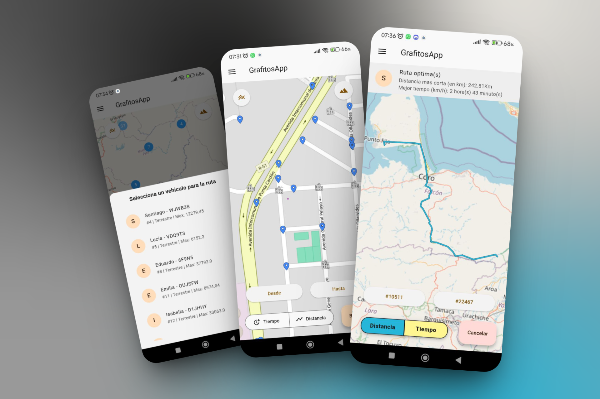

# proyecto_grafitos

GrafitosApp is a cutting-edge route-finding application developed as a university project. It uses a sophisticated map-based algorithm to provide users with the most efficient travel paths. The app integrates two powerful graph search algorithms, Dijkstra's and A (A-star)*, to calculate optimal routes.

Dijkstra's algorithm is known for finding the shortest path between nodes in a graph, while the A* algorithm uses a heuristic approach to significantly improve search speed and efficiency, making it ideal for real-time route planning.

GrafitosApp also offers the flexibility of integrating with external APIs, allowing for a wide range of potential features, such as real-time traffic updates, public transportation schedules, or even ride-sharing services.
